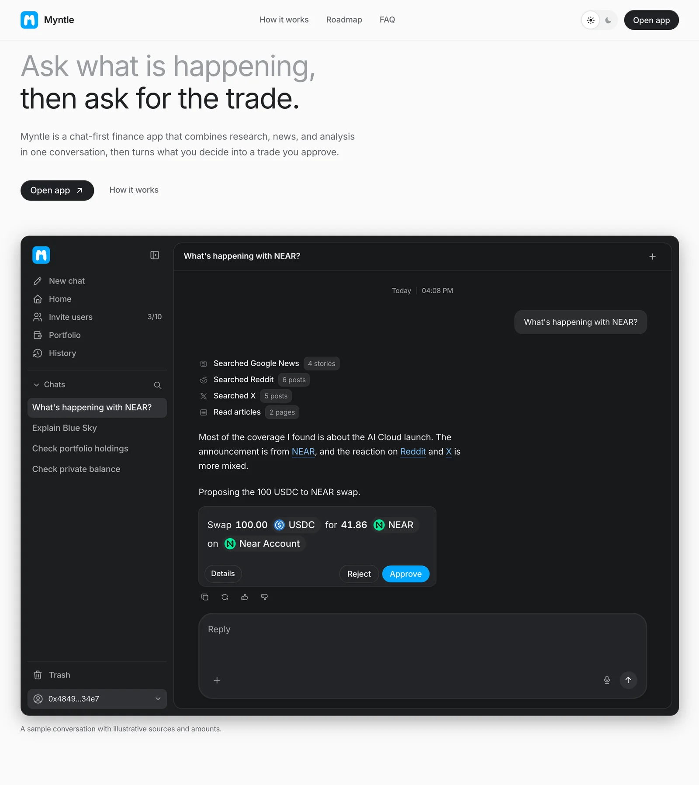
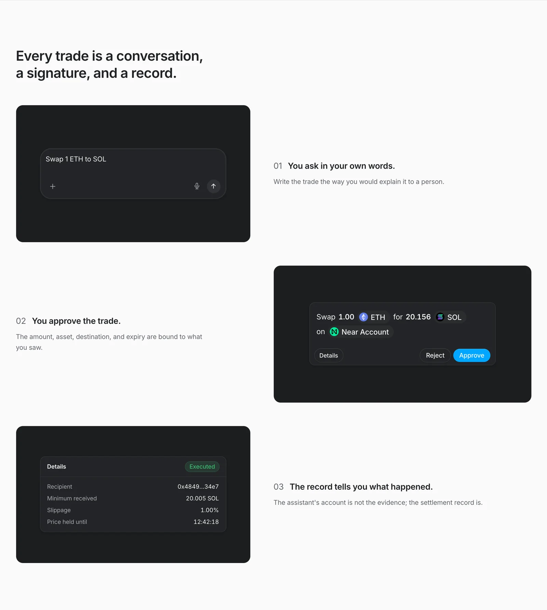
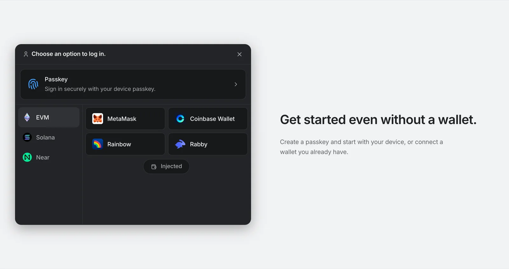

<p align="center">
  <a href="https://github.com/myntlefinance">
    
  </a>
</p>

<h1 align="center">Myntle</h1>

<h3 align="center">Ask what is happening, then ask for the trade.</h3>

<p align="center">
  <sub>The landing page for a chat-first finance app.</sub>
</p>

<p align="center">
  <a href="#the-product"><strong>The product</strong></a> ·
  <a href="#the-page"><strong>The page</strong></a> ·
  <a href="#run-it-locally"><strong>Run it locally</strong></a>
</p>

<br />

<p align="center">
  <picture>
    <source media="(prefers-color-scheme: dark)" srcset="./.github/assets/readme/hero-dark.webp" />
    <source media="(prefers-color-scheme: light)" srcset="./.github/assets/readme/hero-light.webp" />
    
  </picture>
</p>

## The product

Myntle is a chat-first finance app for the wallet you already have. You ask a question in your own words. The assistant reads the news, Reddit, X, and the articles behind them, and when the answer leads to a trade it proposes one you can approve. Myntle never holds your keys or your funds.

- The research happens in the conversation, and every source is named.
- The approval binds the amount, destination, and expiry to what you saw.
- The settlement record, not the assistant, says what happened.

## The page

This repository is the landing page. It shows the product as working interface rather than as screenshots, using the product's own tokens and marks.

<p align="center">
  <picture>
    <source media="(prefers-color-scheme: dark)" srcset="./.github/assets/readme/how-it-works-dark.webp" />
    <source media="(prefers-color-scheme: light)" srcset="./.github/assets/readme/how-it-works-light.webp" />
    
  </picture>
</p>

<p align="center">
  <picture>
    <source media="(prefers-color-scheme: dark)" srcset="./.github/assets/readme/wallets-dark.webp" />
    <source media="(prefers-color-scheme: light)" srcset="./.github/assets/readme/wallets-light.webp" />
    
  </picture>
</p>

## Run it locally

You need Bun and Node 22 or newer.

```bash
bun install
cp .env.example .env.local
bun run dev
```

The page opens at [localhost:3000](http://localhost:3000). `bun run typecheck`, `bun run lint`, and `bun run build` must pass before a change lands.

<details>
<summary>Configuration</summary>

<br />

| Variable | What it does |
|---|---|
| `NEXT_PUBLIC_APP_URL` | The deployed Myntle app. Every "Open app" action points here, and the build falls back to `app.myntle.xyz`. |
| `NEXT_PUBLIC_SITE_URL` | The canonical landing-page origin used for metadata. Vercel's production origin is used when this is absent. |
| `NEXT_PUBLIC_GITHUB_URL` | The project repository used by the footer and documentation links. |
| `NEXT_PUBLIC_X_URL` | The project's X account. Set this before publishing. |

</details>

<p align="center">
  <sub>The conversation and its amounts are illustrative.</sub>
</p>
